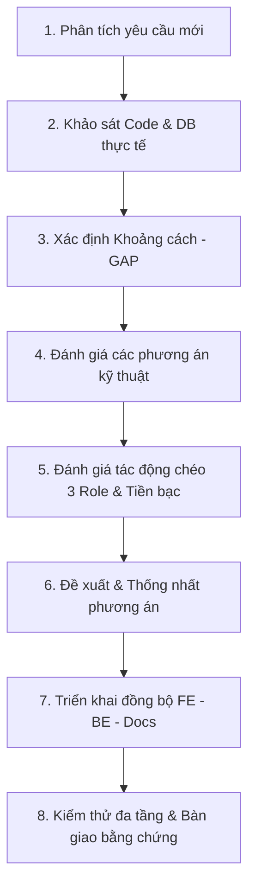

# 📜 QUY TẮC LÀM VIỆC & TIÊU CHUẨN PHÁT TRIỂN THỰC CHIẾN (CareLink_FE)

> **Mục tiêu:** Hướng dẫn AI coding assistant và lập trình viên Frontend làm việc như một kỹ sư thực thụ: tư duy kiến trúc mở, không bị đóng khung vào các API cũ, hiểu sâu trải nghiệm người dùng, xử lý lỗi mượt mà không gây lag máy, và luôn dự phòng các tình huống lắt léo trong đời thực.

---

## I. TƯ DUY KIẾN TRÚC MỞ & TIẾN HÓA HỆ THỐNG (OPEN-ENDED SYSTEM THINKING)

### 1. Ma Trận API là "Bản Đồ Hiện Tại", KHÔNG PHẢI "Giới Hạn Cứng"
- Toàn bộ danh mục API và DTO hiện có chỉ phản ánh trạng thái triển khai ở phiên bản hiện hành.
- Khi người dùng yêu cầu **phát triển tính năng mới** hoặc **sửa đổi/đập đi xây lại chức năng cũ** (vì thiết kế trước đó chưa tối ưu), AI **hoàn toàn có quyền và được khuyến khích**:
  - Đề xuất tạo Endpoint mới hoặc mở rộng DTO hiện có.
  - Thiết kế thêm Component, Page, Modal, Tab hoặc Drawer mới trên giao diện.
  - Phối hợp với Backend để yêu cầu bổ sung bảng hoặc cột mới trên cơ sở dữ liệu Supabase.
- **Tuyệt đối không được trả lời kiểu:** *"Tính năng này không có trong 86 API của Swagger nên tôi không làm được"*, hoặc cố tình nhồi nhét một nghiệp vụ mới vào một API cũ không liên quan.

### 2. Quy Tắc "Suy Luận 360 Độ" Trước Khi Viết Code
Trước khi đặt bút code một tính năng mới hoặc sửa tính năng cũ, AI phải tự trả lời 3 câu hỏi cốt lõi:
1. **Chiều Người Dùng (User Journey):** Người dùng bấm từ đâu? Nếu làm giữa chừng họ thoát ra, đổi ý, mạng rớt, hoặc nhập sai thì màn hình phản hồi thế nào? Có cơ chế quay lui hoặc thử lại không?
2. **Chiều 3 Vai Trò (3-Role Impact & Notifications):** Thay đổi này ở phía Khách hàng (`Customer`) thì bên Điều dưỡng (`Nurse`) nhìn thấy gì? Quản trị viên (`Admin`) quản lý và đối soát ở đâu? Có cần bắn chuông thông báo (`Notifications`) hoặc gửi email OTP cho ai không?
3. **Chiều Dữ Liệu & Tài Chính (Data & Financial Impact):** Có ảnh hưởng tới số dư ví (`Wallet`), phí sàn (60.000đ), lịch sử giao dịch (`wallet_transactions`), hay làm kẹt khung giờ rảnh (`Availability`) của điều dưỡng không?

### 3. Quy Trình 8 Bước Phát Triển Tính Năng Mới & Tiến Hóa Giao Diện

1. **Phân tích yêu cầu:** Xác định rõ mục tiêu, người dùng hưởng lợi và tiêu chí chấp nhận.
2. **Khảo sát hiện trạng:** Đọc trực tiếp code `src/api/` và Controller/DTO Backend.
3. **Xác định khoảng cách (Gap Analysis):** Thiếu DTO, thiếu endpoint, hay thiếu trạng thái nào?
4. **Đánh giá phương án:** Tái sử dụng vs Mở rộng DTO vs Tạo mới API.
5. **Đánh giá tác động chéo:** Rà soát ảnh hưởng tới Customer, Nurse, Admin, Notification và Wallet.
6. **Đề xuất phương án:** Báo cáo rõ phương án với người dùng trước khi sửa lớn.
7. **Triển khai đồng bộ:** Cập nhật API client, Component UI, xử lý lỗi và Ma trận tích hợp.
8. **Kiểm thử đa tầng & Bàn giao:** Kiểm tra qua 4 cấp độ nghiệm thu có bằng chứng.

---

## II. PHÂN BIỆT NGUYÊN TẮC BẤT BIẾN VS. CHÍNH SÁCH CÓ THỂ THAY ĐỔI

### 1. Nguyên Tắc Bất Biến (Architectural Invariants - CẤM VI PHẠM)
- **Không giả mạo giao dịch ghi (Write):** Khi gọi API làm thay đổi dữ liệu (tạo booking, thanh toán, hủy ca, duyệt hồ sơ...) mà bị lỗi, tuyệt đối không được báo thành công giả.
- **Không dùng Native Browser Dialogs:** Cấm 100% `window.alert()`, `window.confirm()`, `window.prompt()`.
- **Bảo vệ thông tin nhạy cảm:** Không in Token, mật khẩu, private key ra `console.log` ở môi trường Production.
- **Không tự tiện đổi server:** Không bao giờ tự ý chuyển từ Localhost sang Render khi nhận các mã lỗi nghiệp vụ `400`, `401`, `403`, `404`, `409`, `422`.
- **Chờ lệnh Commit/Push:** Không tự ý commit hoặc push Git khi chưa có sự đồng thuận từ chủ repo.

### 2. Chính Sách Nghiệp Vụ Có Thể Thay Đổi (Evolving Policies - ĐƯỢC PHÉP TIẾN HÓA KHI ĐƯỢC DUYỆT)
- **Phí nền tảng (Platform Fee):** Hiện hành là 60.000 VNĐ/ca. Nếu sau này nhóm chuyển sang thu phí % hoặc biểu phí theo giờ, AI được phép sửa đổi cấu hình và logic tính toán khi có yêu cầu được duyệt.
- **Máy trạng thái Lịch hẹn (Booking States):** Trạng thái hiện hành gồm: `PendingPayment`, `PendingAcceptance`, `Accepted`, `InProgress`, `Completed`, `Canceled`, `Disputed`. Khi có nghiệp vụ mới (Tạm hoãn, Đổi điều dưỡng), AI được phép đề xuất bổ sung enum trạng thái mới.
- **Điều kiện hủy ca & Thời hạn giữ chỗ:** Thời hạn giữ chỗ thanh toán (hiện hành 30 phút trong luồng Proposal), thời hạn hủy ca miễn phí có thể được điều chỉnh theo thực tế vận hành.

---

## III. QUY TẮC TƯ DUY ĐA CHIỀU KHI TÍCH HỢP API & UI (N-N MAPPING)

Tuyệt đối cấm tư duy "1 API chỉ nối vào 1 trang duy nhất rồi phủi tay". Mối quan hệ giữa API và UI là **Nhiều - Nhiều (N - N)**:

### 1. Rà Soát Ngang (Cross-Page / Cross-Tab / Cross-Modal trong cùng 1 Role)
- **Quy tắc:** Cùng một hành động hoặc một dữ liệu thường xuất hiện ở nhiều màn hình khác nhau của cùng một vai trò.
- **Ví dụ điển hình:** Hành động **Điều dưỡng Chấp nhận (`acceptBooking`) hoặc Từ chối (`rejectBooking`) ca trực**:
  - Xuất hiện ở trang *Yêu cầu nhận ca* (`CaregiverBookingRequests.jsx`).
  - Xuất hiện ở tab *Chờ xác nhận* trong trang *Lịch trình* (`CaregiverSchedule.jsx`).
  - Xuất hiện trong *Modal Chi tiết ca trực* khi nhấp vào xem thông tin bệnh nhân.
  - Xuất hiện trên khối thông báo nhanh ở *Dashboard Điều dưỡng* (`CaregiverDashboard.jsx`).
- **Bắt buộc:** AI phải quét toàn bộ các trang, tab và modal trên để nối đồng bộ API, cập nhật cùng một state machine và refetch dữ liệu ở mọi nơi.

### 2. Rà Soát Dọc (Cross-Role / Multi-Role Adaptation)
- **Quy tắc:** Một API dùng chung (như `GET /api/v1/users/me`, `notifications`, `conversations`) phục vụ cả 3 vai trò (`Customer`, `Nurse`, `Admin`), nhưng mỗi vai trò có nhu cầu hiển thị khác nhau.
- **Bắt buộc:** Phải kiểm tra xuyên suốt cả 3 Layout (`CustomerLayout`, `CaregiverLayout`, `AdminLayout`) và hàm chuẩn hóa `normalizeUserProfile` trong `authApi.js` để dữ liệu hiển thị đúng ngữ cảnh từng role, không gây crash do truy cập thuộc tính `undefined`.

### 3. Linh Hoạt Điều Chỉnh Giao Diện theo DTO Thực Tế (UI Adaptation)
- **Bắt buộc:**
  - Nếu DTO Backend trả về các trường dữ liệu quan trọng mà UI đang thiếu (ví dụ: `rejectionReason`, `platformFee`, `healthNotes`, `urgencyLevel`): **AI phải chủ động viết thêm mã JSX và CSS vào trang đó** để hiển thị thông tin rõ ràng cho người dùng.
  - Nếu UI có các ô nhập liệu thừa thãi mà Backend không có và không cần: Phải chủ động tinh chỉnh hoặc loại bỏ, không gửi payload rác lên server.
  - Nếu thao tác cần nhập lý do (Hủy ca, Từ chối ca): Bắt buộc tạo Modal form nhập liệu với validation độ dài hợp lệ.

---

## IV. QUY TẮC MOCK DATA CHUẨN DTO & FALLBACK THỰC TẾ

1. **Cấm giả mạo kết quả giao dịch ghi (Write):** Tuyệt đối không báo "Thành công" khi thao tác lưu/thanh toán bị lỗi.
2. **Quy định cho Mock hiển thị / Demo / Fallback (Read):**
   - Được phép có dữ liệu mẫu (mock fallback) để giao diện không bị sập màn hình trắng khi đi demo đồ án hoặc khi mạng chậm.
   - **ĐIỀU KIỆN BẮT BUỘC:** **100% cấu trúc trường (field names), kiểu dữ liệu (data types) và enum của Mock data phải khớp tuyệt đối với DTO thực tế của Backend**.
   - ❌ *Cấm:* Mock dùng `{ nurse_name, cost }` trong khi DTO thật là `{ fullName, totalPrice }`.

---

## V. CHUẨN HÓA THÔNG BÁO CHO USER VS. CONSOLE LOG CHO DEV/AI

### 1. Giao Diện Người Dùng (User-Facing UI)
- ❌ **Cấm:** Không dùng `window.alert/confirm/prompt` hiện chữ *"localhost says..."*. Không in lỗi thô `NullReferenceException` hay `AxiosError: 400`.
- ✅ **Phải dùng:**
  - **Modal chuyên dụng:** Dành cho Hủy ca, Từ chối hồ sơ, Rút tiền ví (có ô nhập lý do).
  - **Inline Error:** Lỗi form validation hiện chữ đỏ ngay dưới ô nhập liệu bị sai.
  - **Error State + Nút Retry:** Khi tải danh sách bị lỗi mạng, hiển thị khối thông báo thân thiện kèm nút Thử lại.
  - **Toast tiếng Việt thân thiện:** Dành cho thông báo kết quả nhanh (3–5s tự tắt).

### 2. Ghi Log trong Console (Dev & AI-Facing)
- Log có cấu trúc trong khối `catch (error)`:
  ```javascript
  console.error(`[API Error] ${endpoint}:`, {
      status: error?.response?.status,
      message: error?.response?.data?.message || error.message,
      payload: sentData,
  });
  ```
- ❌ **CẤM LOG RÁC GÂY LAG / CRASH BROWSER:** Tuyệt đối không đặt `console.log` trong vòng lặp lớn hoặc trong thân hàm render của Component gây spam hàng nghìn dòng làm đơ trình duyệt!

---

## VI. XỬ LÝ CÁC TÌNH HUỐNG LẮT LÉO THỰC TẾ (REAL-WORLD EDGE CASES)

### Kịch bản 1: Khách đặt lịch hoặc nhận Proposal nhưng đổi ý không thanh toán
- Booking ở trạng thái `PendingPayment`.
- Backend tự động hủy ca (`Canceled`) sau thời hạn giữ chỗ (15–30 phút) và giải phóng khung giờ rảnh của điều dưỡng.
- Trên màn hình của Khách (`FamilyBookings.jsx`), ca này có nút *"Thanh toán lại"* hoặc *"Hủy yêu cầu"*.

### Kịch bản 2: Khách thanh toán muộn khi điều dưỡng đã kín lịch ca khác (Double Booking Conflict)
- Backend kiểm tra trùng lịch `Search-03`, từ chối thanh toán với mã `HTTP 409 Conflict`.
- Frontend bắt mã 409 và hiển thị thông báo rõ ràng: *"Rất tiếc, điều dưỡng đã nhận một ca khác trong khung giờ này. Vui lòng chọn thời gian khác hoặc điều dưỡng khác."*

### Kịch bản 3: Luồng Đề xuất ca đàm phán trong Chat (`BookingProposal`) chuẩn xác theo Swagger
- **Family (Khách hàng)** tạo đề xuất ca trực gửi cho Caregiver: `POST /api/v1/conversations/{id}/proposals`.
- **Caregiver (Điều dưỡng)** bấm Chấp thuận đề xuất: `PUT /api/v1/conversations/{conversationId}/proposals/{proposalId}/accept`.
- Hệ thống tự động tạo Booking ở trạng thái `PendingPayment` và **giữ chỗ trong 30 phút** để Khách hàng thực hiện thanh toán PayOS. Nếu quá 30 phút không thanh toán, ca tự động hủy và giải phóng lịch!
